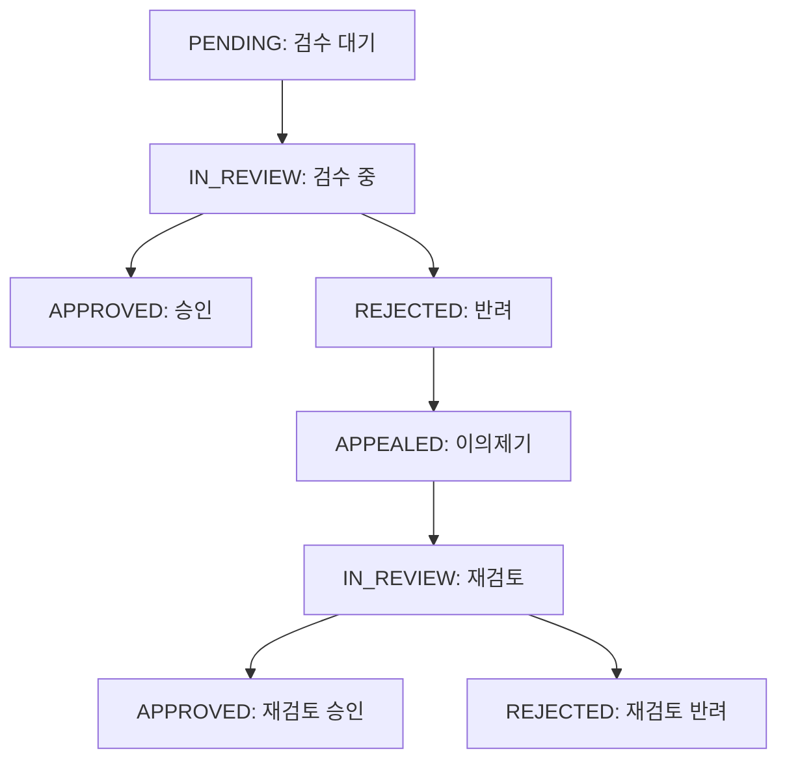

# 2026-11-09 TIL — T80 운영 콘텐츠 검수 정책·상태 모델 설계

## 오늘의 목표

AI Career Platform에서 **기업·채용 공고·사용자 콘텐츠를 어떻게 검수할지 운영 정책의 초안**을 만들고, 상태 흐름도를 작성해 GitHub PR로 제출하기.

오늘은 실제 검수 기능을 개발하거나 운영 DB를 바꾼 날이 아니다. **정책 문서 작성 → 상태 다이어그램 → Git 협업 → Redmine 일감 확인**까지 진행했다.

- 기능 추적: **F-027**
- 담당 작업: **T80 운영 콘텐츠 검수 정책·상태 모델**
- [GitHub PR #145](https://github.com/ai-career-platform/ai-career-platform/pull/145)
- [Redmine 일감 #1592](https://sulfite-footbath-next.ngrok-free.dev/issues/1592)

## 1. 내가 맡은 T80은 무엇일까?

쉽게 말하면 취업 플랫폼에서 **운영자가 어떤 콘텐츠를 어떤 규칙으로 승인하거나 반려할지 정하는 일**이다.

예를 들어 기업이 채용 공고를 등록했는데 허위 정보나 부적절한 비용 요구가 있다면, 운영자는 이를 검토해야 한다. 단순히 '반려' 버튼을 누르는 것만 생각해서는 안 된다.

- 기업 정보, 채용 공고, 사용자 콘텐츠 중 무엇을 검수할까?
- 운영자 중 누가 승인·반려할 수 있을까?
- 반려 이유는 어떻게 기록하고 전달할까?
- 기업이 이의제기하면 누가 다시 검토할까?
- 검수 기한과 감사 기록은 어떻게 정할까?

이 질문에 대한 **정책 후보**를 문서로 정리했다. 실제 운영 규칙으로 확정한 것은 아니다.

## 2. 먼저 기존 문서를 읽었다

VS Code에서 다음 문서를 확인했다.

| 파일 | 확인 내용 |
|---|---|
| `docs/FULL_SCOPE_TRACEABILITY.md` | F-027 운영 콘텐츠 검수, UI-027 관리자 검수 후보 |
| `docs/API_CONTRACT.md` | 검수 목록 조회·승인/반려 결정 API 후보 |
| `database/FULL_DATABASE_MODEL.md` | `moderation` 검색 결과 없음 |
| `docs/AI_SYSTEM_ARCHITECTURE.md` | `moderation` 검색 결과 없음 |

API 계약에서 확인한 검수 기능 후보는 다음과 같았다.

- `GET /admin/reviews`: 관리자 검수 목록 조회
- `POST /admin/reviews/{review_id}/decision`: 특정 검수 건에 대한 결정

이 경로는 **설계 문서의 후보**이지 실제 운영 API 구현을 확인한 결과가 아니다. API 계약에는 `moderation_reviews` 관련 테이블이 S03에 없다고 표시되어 있었다. 다른 명칭으로 존재하는지와 최종 모델은 추가 확인이 필요하다.

### 선행조건도 확인했다

- **T04:** 전체 기능·화면 요구사항 기준선 확정
- **T05:** DB ERD 및 테이블 계약 확정
- **T06:** API·DTO 계약 확정

T04와 T05 지시서 상태는 `READY_FOR_REVIEW`였고, 이는 완료나 PM 승인을 의미하지 않았다. T06 완료 증빙도 확인하지 못했다. 따라서 **실제 API·DB 연동은 HOLD**, 문서 설계 초안까지만 진행했다.

## 3. 검수 정책 문서를 직접 만들었다

VS Code의 프로젝트 `ai-career-platform`에 다음 파일을 작성했다.

```text
docs/
└── admin/
    ├── MODERATION_POLICY.md
    └── MODERATION_STATE_DIAGRAM.md
```

`MODERATION_POLICY.md`에 정리한 항목:

1. 문서 목적과 미승인 상태
2. 기업 정보·채용 공고·사용자 콘텐츠 검수 범위 후보
3. 검수 상태와 상태 전이
4. 검수 운영자·관리자·기업·일반 사용자 권한 후보
5. 반려 사유와 이의제기 기준
6. 처리 기한 및 우선순위 후보
7. 예외 처리와 보안
8. 데이터 모델·감사 이벤트 후보
9. 정상·실패·권한 검증 테스트 계획
10. PM 승인 필요 항목과 구현 제한

핵심은 **정책을 마음대로 확정하지 않고 '미확정 사항'으로 남기는 것**이었다.

## 4. State Machine(상태 머신)을 배웠다

State Machine은 어떤 대상이 **현재 어떤 상태인지**, 또 **어떤 상태로 바뀔 수 있는지** 정하는 규칙이다.

채용 공고의 검수 흐름을 후보로 설계했다.



상태 이름과 이의제기 반복 허용 여부, 재검토 종료 조건은 **승인 전 제안**이다.

Mermaid라는 문법을 이용하면 그림을 마우스로 일일이 그리지 않아도 텍스트로 흐름도를 만들 수 있다. `MODERATION_STATE_DIAGRAM.md` 파일을 작성하고 VS Code에서 `Ctrl + Shift + V`로 Markdown 미리보기를 열어 **그림이 정상 표시되는 것을 확인**했다.

## 5. GitHub 협업을 직접 해봤다

정책 문서를 작성한 뒤 PowerShell 터미널에서 파일과 브랜치 상태를 확인했다.

```powershell
git status
Get-ChildItem docs/admin
git switch -c task/t80-moderation-policy
git status --short --branch
git push -u origin task/t80-moderation-policy
```

이 과정에서 배운 것:

| 명령어 | 내가 이해한 뜻 |
|---|---|
| `git status` | 지금 어떤 파일이 변경되었는지 확인 |
| `Get-ChildItem docs/admin` | 폴더에 문서 두 개가 있는지 확인 |
| `git switch -c` | 내 작업을 분리할 개인 브랜치 만들기 |
| `git push -u origin` | 작업 브랜치를 GitHub에 올리고 원격 추적 설정 |

브랜치 생성 당시 로컬 `main`은 `origin/main`보다 112개 커밋 뒤처져 있었다. 개인 브랜치에서 작업했으며, 기존 공용 Staging이나 운영 설정을 변경하지 않았다.

### PR 제출

- PR: [ai-career-platform/ai-career-platform#145](https://github.com/ai-career-platform/ai-career-platform/pull/145)
- 브랜치: `task/t80-moderation-policy`
- 확인한 변경 파일: **2개**
- 추가된 줄: **348줄**
- 확인한 커밋: `7af876ae75d04583be448dc834e42052196c8cc4`

PR 생성은 완료되었지만, 확인 당시 **Open / 미병합 / 리뷰 승인 전**이었다. GitHub CI #378 성공을 확인했지만, 이 성공만으로 정책의 권한·보안 테스트가 통과했다고 말할 수 없다. 실제 API/DB 테스트를 수행한 것도 아니다.

## 6. Redmine 일감도 확인했다

기존에 만들어진 [Redmine #1592](https://sulfite-footbath-next.ngrok-free.dev/issues/1592)가 T80에 해당한다는 것을 찾았다.

당시 화면에는 담당자와 함께 `Resolved`, 진척도 `100%`가 표시되어 있었다. 하지만 **Redmine 표시와 실제 PM 정책 승인 및 PR 병합은 다른 것**이므로 최종 완료 판정은 추가 확인이 필요하다.

Redmine 댓글에 PR #145 링크가 실제 등록됐는지는 아직 확인하지 못했다. 동일한 일감을 중복 생성하지 않고 기존 일감을 활용하는 것이 중요하다는 점도 배웠다.

## 7. 오늘 배운 핵심 개념

- **Moderation(검수):** 게시할 콘텐츠가 운영 정책에 맞는지 살피는 일.
- **Policy(정책):** 승인·반려·이의제기 등의 기준과 절차.
- **State Machine:** 허용된 상태와 상태 변경 규칙.
- **권한 검증:** 로그인 여부와 역할에 따라 허용되는 작업을 확인.
- **403 Forbidden:** 인증된 요청자에게 해당 작업 권한이 없을 때의 오류.
- **409 Conflict:** 중복 결정이나 현재 상태와 요청이 충돌하는 경우의 오류 후보.
- **Mermaid:** 코드처럼 작성하는 다이어그램 문법.
- **PR(Pull Request):** 내가 만든 변경 내용을 팀에 검토·병합 요청하는 것.
- **Redmine:** 누가 어떤 일감을 맡고 어떤 상태인지 관리하는 도구.
- **HOLD:** 선행조건이나 승인이 없어 실제 구현을 보류한 상태.

## 8. 오늘의 회고

처음에는 T04·T05·T06을 찾아보느라 T80이 아니라 다른 작업을 하는 것처럼 느껴졌다. 나중에 이것들이 **T80을 안전하게 진행하기 위한 선행조건**이라는 점을 이해했다.

오늘 만든 것은 실제로 작동하는 검수 시스템이 아니라 **개발과 운영을 위한 정책 설계도**다. 문서를 GitHub PR로 올리고 Redmine 일감과 연결하는 것도 팀 개발에서 중요한 과정이라는 것을 배웠다.

## 9. 다음에 할 일

- [ ] T04/T05/T06의 실제 완료 증빙 및 PM 승인 확인
- [ ] 검수 상태 전이·승인 권한·반려 사유·이의제기 종료 조건 리뷰 요청
- [ ] Redmine #1592에 PR #145 링크가 등록되었는지 확인
- [ ] 정책이 승인되면 Mock 또는 격리 환경 테스트 계획과 결과 제출
- [ ] PR 리뷰·CI 검증 범위·최종 T80 상태 확인

**오늘의 정확한 결과:** T80 정책·다이어그램 **초안 작성 및 PR 제출 완료**. 실제 API/DB 구현, 운영 정책 승인, 전체 일감 완료는 아직 확인되지 않았다.
